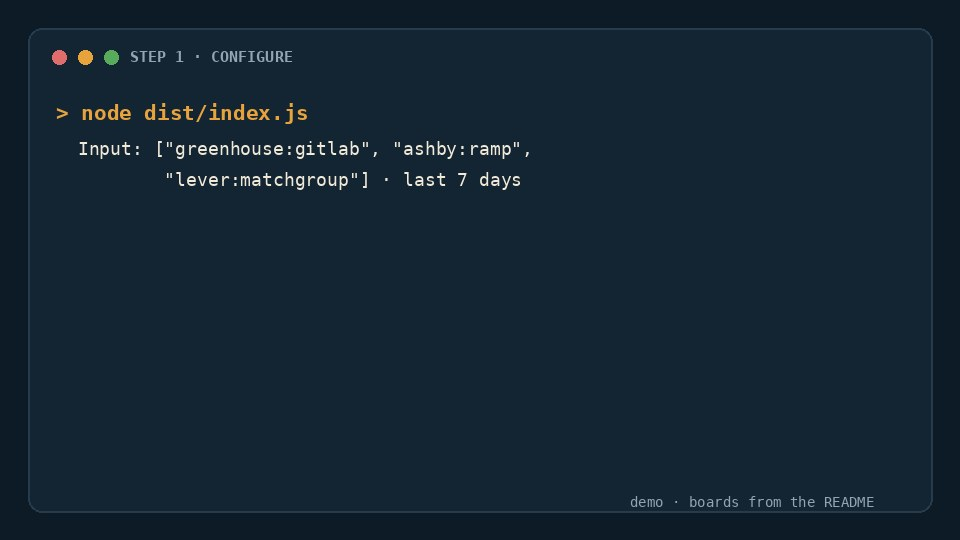
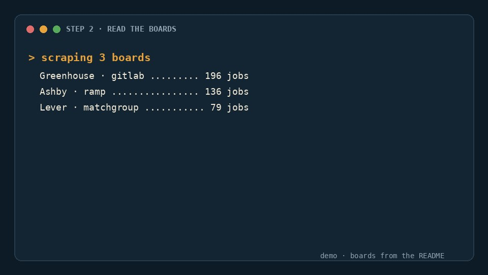
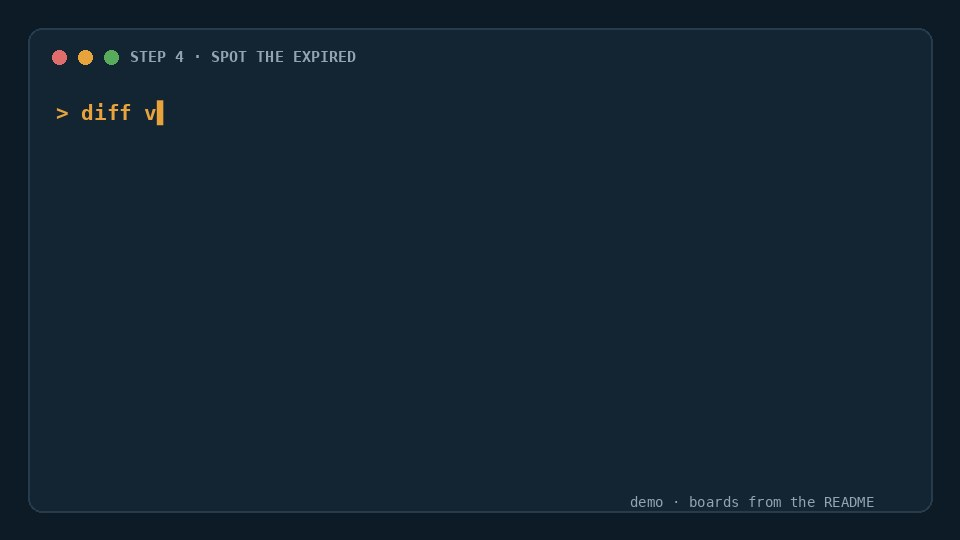

# ATS Job Scraper

Reads job adverts straight from company career pages and returns them as one consistent set of fields, whichever recruitment system the company happens to use.

Most companies do not build their own careers page. They use recruitment software (an ATS), and a handful of those systems cover a large share of the market. Those systems publish their listings in a machine-readable form, because that is how the careers page on the company's own website gets populated. This reads that same feed, normalises ten different shapes into one, and hands you the result.

If you are not a developer, read [ONE-PAGER.md](ONE-PAGER.md) instead. It covers what this does and what it costs without the implementation detail.

Runs as an [Apify](https://apify.com) Actor, or as a plain Node script.

The docs are also available as [llms.txt](llms.txt) for coding agents.

## Watch how it works

One run takes about 25 seconds to watch, with the boards the README verified live.

<table>
  <tr>
    <td align="center" width="33%"><a href="https://github.com/splashdeluxe/open-ats-jobs/blob/main/assets/demo.gif"></a><br><code>configure</code>: three boards in</td>
    <td align="center" width="33%"><a href="https://github.com/splashdeluxe/open-ats-jobs/blob/main/assets/demo.gif"></a><br><code>read the boards</code>: one schema out</td>
    <td align="center" width="33%"><a href="https://github.com/splashdeluxe/open-ats-jobs/blob/main/assets/demo.gif"></a><br><code>spot the expired</code>: what closed</td>
  </tr>
</table>

## What makes the data different

Job aggregators carry the same role three times: once from the employer, once from an agency, once from a recruiter who is not hiring at all. Half the links are dead by the time you read them. That is not a scraping problem, it is what a site where anyone can post anything looks like.

This never touches an aggregator. Every posting comes from the employer's own careers page, so there is one row per role and the apply URL points at the company's actual application form rather than a redirect chain.

Greenhouse, Workday, Ashby, Lever, Workable, Personio, Recruitee, Breezy, Rippling and SmartRecruiters all return different shapes. You get one. Locations arrive as free text ("Remote, Italy", "München", "NY HQ") and come back as structured city, region and country; pay is extracted wherever the employer published it.

The part worth calling out is expiry. Every run reads a company's complete board, so anything that disappeared since last time is written to a separate `expired-jobs` dataset. Most job feeds cannot tell you this, because they only ever see additions.

## Platform coverage

Verified against live boards on 2026-08-18. Every connector below was confirmed by an actual run, not by reading documentation.

| Platform | Endpoint | Verified against | Descriptions |
|---|---|---|---|
| Greenhouse | `boards-api.greenhouse.io/v1/boards/{slug}/jobs` | `gitlab` (196 jobs) | inline |
| Ashby | `api.ashbyhq.com/posting-api/job-board/{slug}` | `ramp` (136) | inline |
| Lever | `api.lever.co/v0/postings/{slug}` | `matchgroup` (79) | inline |
| Workable | `apply.workable.com/api/v1/widget/accounts/{slug}` | `viva` (41) | inline |
| Personio | `{slug}.jobs.personio.de/xml` | `urbansportsclub` (38) | inline (XML) |
| Recruitee | `{slug}.recruitee.com/api/offers/` | `nmbrs` (3) | inline |
| Breezy HR | `{slug}.breezy.hr/json` | `breezy` (3) | list only |
| Rippling | `api.rippling.com/platform/api/ats/v1/board/{slug}/jobs` | `rippling` (375) | second request |
| Workday | POST `{tenant}.{pod}.myworkdayjobs.com/wday/cxs/...` | `nvidia` (2000) | second request |
| SmartRecruiters | `api.smartrecruiters.com/v1/companies/{slug}/postings` | `Visa` (2) | **disabled by default**, see Compliance |

Ten platforms, nine of them on by default. Scope is deliberate rather than exhaustive: several other systems (Teamtailor, Freshteam, Zoho, Comeet) require a paid API key, and some publish no readable feed at all. Adding one that does is a single file plus one line in `src/connectors/index.ts`.

`seeds/companies.json` ships 179 company boards that were verified working on the same date, holding 18,830 jobs between them. Set `useSeedList: true` to crawl them.

## Quickstart

```bash
npm install
npm run build
```

Create `storage/key_value_stores/default/INPUT.json`:

```json
{
  "companies": ["greenhouse:gitlab", "ashby:ramp", "lever:matchgroup"],
  "timeRange": "7d",
  "maxJobs": 500,
  "includeDescription": true
}
```

Then run it:

```bash
APIFY_LOCAL_STORAGE_DIR=./storage APIFY_PURGE_ON_START=0 node dist/main.js
```

Results land in `storage/datasets/default`. Set `APIFY_PURGE_ON_START=0` or the local run wipes its own state between runs and the incremental logic never engages.

You can pass careers URLs instead of knowing the platform:

```json
{ "careerUrls": ["https://jobs.lever.co/matchgroup", "https://boards.greenhouse.io/gitlab"] }
```

## Output

Field names follow the convention common to job-data APIs, so an existing ingestion pipeline generally works unchanged.

```
id, title, organization, url, apply_url
date_posted, date_created, date_first_seen
locations_raw, locations_derived[{city,admin,country}]
cities_derived, regions_derived, countries_derived, lats_derived, lngs_derived
location_type, description_text, description_html
salary_raw, employment_type, department
source, source_domain, domain_derived

ai_salary_currency, ai_salary_min_value, ai_salary_max_value, ai_salary_unit_text
ai_employment_type, ai_work_arrangement, ai_work_arrangement_office_days
ai_experience_level, ai_visa_sponsorship, ai_job_language, ai_taxonomies_a

ai_key_skills, ai_core_responsibilities, ai_requirements_summary   (only when enrichment is on)
```

Despite the `ai_` prefix, everything above the last line is extracted without a model. The prefix exists for drop-in compatibility, not because a model produced it.

Measured over a 905-job run across all nine default platforms:

| Field | Coverage |
|---|---|
| title, url, date_posted | 100% |
| employment type | 100% |
| work arrangement | 99% |
| taxonomy | 98% |
| country | 97% |
| description text | 95% |
| language | 94% |
| city | 84% |
| experience level | 82% |
| geocoded (lat/lng) | 49% |
| salary | 21% |

Salary sits at 21% because most employers do not publish one, not because extraction fails. Geocoding is capped by a bundled table of ~180 major hiring cities; jobs elsewhere get a city and country but no coordinates. That is a deliberate trade for having no geocoding API bill and no network call.

## Keeping it cheap

The design assumption is that you will run this on a schedule, so per-run cost matters more than anything else.

Deterministic extraction comes first. Ashby accepts `includeCompensation=true`, Greenhouse and Workday carry structured pay and employment metadata, and many boards embed a schema.org `JobPosting` block. Parsing those is free and more accurate than asking a model to read a number off a page. A model is only used for the three fields that genuinely need reading comprehension.

Enrichment ships off. It needs your own `ANTHROPIC_API_KEY`, and the deterministic `ai_*` fields populate whether or not you enable it.

Descriptions are fetched last. Workday and Rippling charge one request per job for the description, so that happens after deduplication, after filtering and after the `maxJobs` cap. On a 700-job Rippling board pulling 20 jobs, that is 20 requests instead of 700. Getting this order wrong was the single biggest cost bug during development.

Unchanged boards are skipped. An ETag (or a content hash, when the platform sends no ETag) is stored per company; a board that has not changed is never downloaded.

Enrichment results are cached on a hash of the description text, so a repost or a re-seen job never costs twice.

All of that depends on `stateStoreName`, which must be a **named** key-value store. Apify recreates a run's default store on every run, so state kept there vanishes between runs and incremental delivery, expiry detection and caching all silently stop working while still appearing fine in local testing. The default name is `open-ats-jobs-state`; give separate feeds separate names so they do not share a seen-list. Two runs sharing a name concurrently will race on the state object, last write winning — fine on a schedule, wrong for parallel fan-out.

Set `resetState: true` when you want every job matching your filters rather than only the ones not returned before.

Requests ask for gzip, the default memory is 256 MB, and no proxy is used unless you configure one. None of the default platforms need one.

## Incremental runs and expiry

State lives in the Actor's key-value store: which job URLs have been seen, when each was first seen, and the current ETag per board.

`timeRange` filters on `date_posted` and also suppresses anything already seen, so a scheduled run emits only genuinely new jobs. Verified on the Apify platform across two consecutive runs against the same boards: N jobs on the first, 0 on the second, with both boards skipped without downloading. Verify this on the platform rather than locally — the local default store persists on disk and will hide a state bug that breaks every scheduled run.

Job hashes present last run and missing this run are written to a separate `expired-jobs` dataset. Expiry is scoped to boards actually crawled in that run, so a company skipped because of a rate limit or a transient error does not get its entire board declared dead.

## Compliance

SmartRecruiters is disabled by default. Its `robots.txt` reads `User-agent: * / Disallow: /`, with an explicit carve-out only for LinkedInBot. The connector is written and works, but it takes an opt-in flag and logs a warning quoting the directive when enabled, so the decision is recorded rather than silently defaulted.

Lever publishes `Crawl-delay: 1`, honoured by per-host rate limiting. Greenhouse disallows only `/embed/`. Workday tenants allow their career-site paths.

Only public, unauthenticated endpoints are used. No auth bypass, no CAPTCHA handling. Requests carry an identifiable User-Agent with a contact URL, back off exponentially, and are capped per host.

`includeContactInfo` defaults to off. Job adverts sometimes name a recruiter, which is personal data under GDPR; with the flag off, email addresses and phone numbers are redacted from descriptions before anything is written.

## Development

```bash
npm run typecheck
npm test          # 69 tests, fixture-driven, no network
```

Tests run against real payloads captured from each platform and committed to `fixtures/`. They cover connector parsing, the normalisation layer, money parsing across US and European number formats, location resolution, Workday's relative dates ("Posted 3 Days Ago"), and extraction-coverage floors so a regression in derivation fails the build.

```
src/
  connectors/     one file per platform, plus the registry
  normalize/      schema, derive (the free path), location, salary, dates
  enrich/         optional model enrichment, behind a flag, with caching
  state.ts        seen-hashes and ETags
  filters.ts      include/exclude, with a listing-only mode for the cheap first pass
  fetcher.ts      concurrency, per-host delay, retries, conditional requests
  main.ts         orchestration
```

Adding a platform means implementing `listRequests` / `parseList` / `detect`, plus `nextPage` and `detailRequest` if the platform needs them, then one line in the registry.

## Known limitations

Several of these endpoints are undocumented and can change without notice. The fixture tests surface breakage quickly and the registry keeps each fix to one file, but this needs maintenance. It is not set-and-forget.

The live enrichment call is not covered by an end-to-end test, because no API key was available in the build environment. The failure path is verified: with enrichment on and no key, rows still ship with every deterministic field populated and the three model-only fields null. The successful path is typechecked against the current SDK but has not been run against the live API.

There is no historical archive. The tool knows what is on a board now and what was there last run.

## Licence

MIT.
